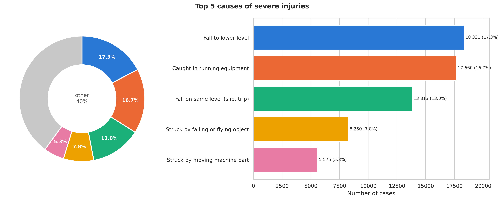
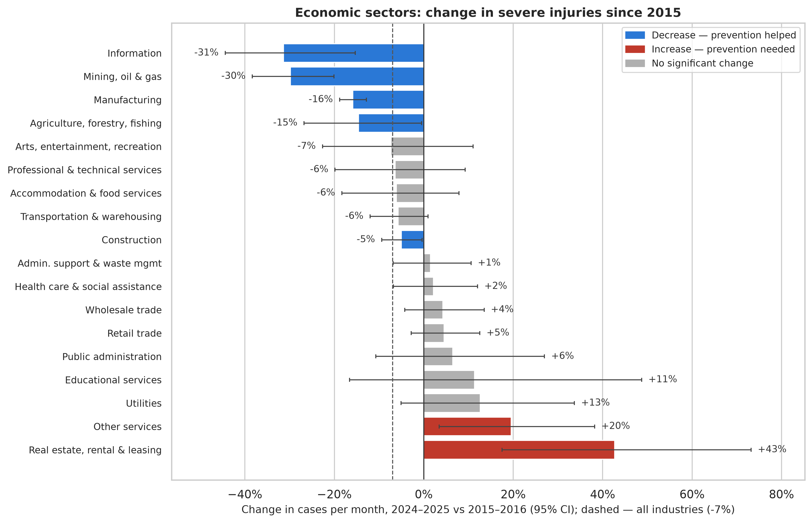
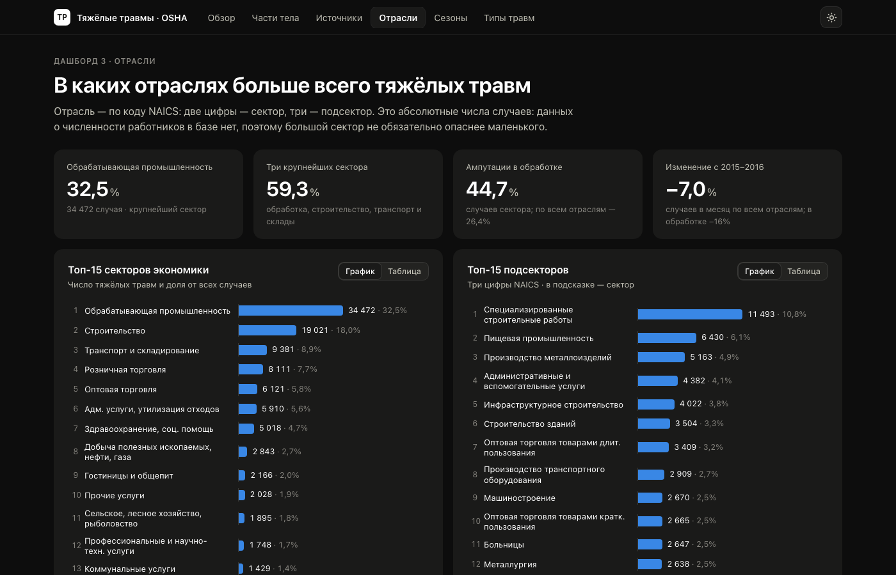
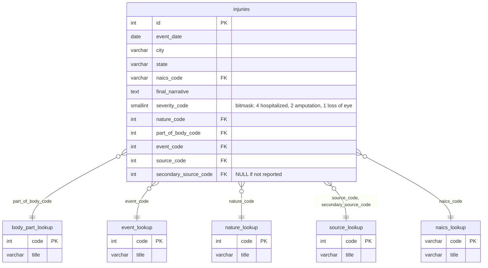

# Severe Work Injuries in the US: OSHA Database and Analysis

[Русская версия](README.ru.md) · **[Interactive dashboards](https://samuelhidden.github.io/osha-severe-injuries/Report/)**

A PostgreSQL database built from OSHA Severe Injury Reports (**105,996 cases, January 2015 – November 2025**),
plus SQL and Python analysis of which body parts, injury sources, causes, industries and states account for the
most severe work injuries, and where injury counts have fallen or risen since 2015.

**Stack:** PostgreSQL · SQL · Python (pandas, SQLAlchemy, SciPy, statsmodels) · matplotlib / seaborn · Jupyter

## Key findings

- **Fingers** are the most injured body part: **29%** of all severe injuries, almost one in three.
- **Five causes account for 60% of cases:** falls to a lower level (17.3%), being caught in running equipment
  (16.7%, 72% of which end in amputation), falls on the same level (13.0%), being struck by falling or flying
  objects (7.8%) and being struck by moving machine parts (5.3%).
- **Most frequent sources:** floors and walking surfaces (11.8%), forklifts and pallet jacks (5.7%), ladders (5.6%).
- **Manufacturing (32.5%) and construction (18.0%)** together account for half of all cases; the top 5 sectors
  account for 73%.
- **Change 2024–2025 vs 2015–2016 (cases per month):** −7% across all industries. Manufacturing fell by a
  significant 16%, while warehousing (+32%), repair and maintenance (+31%) and ambulatory health care (+30%) grew
  significantly (95% CI, Poisson rate ratio).





> These are absolute counts; the data has no employment figures, so a decrease may reflect lower employment or
> under-reporting as well as better prevention. States with their own OSHA-approved programs (State Plans,
> e.g. California) are under-represented.

## Interactive dashboards

Five static HTML dashboards (in Russian, no external libraries): body parts, injury sources, industries,
seasonality and injury types, with tooltips, chart/table toggles and light/dark themes.
**[Open online](https://samuelhidden.github.io/osha-severe-injuries/Report/)**, or open `Report/index.html` locally. PDF versions are in [`Report/pdf`](Report/pdf).

[](https://samuelhidden.github.io/osha-severe-injuries/Report/03_industries.html)

## Database

A star schema with one fact table and five lookup tables, and all foreign keys enforced.



| Table | Rows | Contents |
|---|---:|---|
| `injuries` | 105,996 | one row per severe injury: date, location, industry, OIICS codes, narrative |
| `source_lookup` | 1,643 | injury sources (OIICS), shared by primary and secondary source |
| `naics_lookup` | 2,442 | industries (NAICS 2022) |
| `event_lookup` | 476 | event types, i.e. how the injury happened (OIICS) |
| `nature_lookup` | 251 | nature of injury: fracture, amputation, burn… (OIICS) |
| `body_part_lookup` | 205 | parts of body (OIICS) |

Schema: [`SQL/00_schema.sql`](SQL/00_schema.sql). Load script: [`SQL/00_load.sql`](SQL/00_load.sql).
Details of the data (OIICS code revisions, legacy NAICS codes, placeholder codes) are in [`SQL/README.md`](SQL/README.md).

## Repository structure

```
Data/
  Raw/                     source CSVs (not in the repo, see "Data sources")
  processed/
    pre-process.ipynb      cleaning and normalisation of the raw export
    prepare_csv.py         split into fact and lookup tables
    DataBaseFiles/         six CSVs ready for loading into PostgreSQL
SQL/
  00_schema.sql            tables, keys, constraints, indexes
  00_load.sql              load the CSVs with \copy
  01–08_*.sql              analytical queries by topic
Analysis/
  notebooks/01–10_*.ipynb  analysis notebooks, each ending with conclusions
  src/                     DB access, chart style, statistics, Russian labels
  figures/en, figures/ru   charts in English and Russian (PNG 300 dpi + SVG)
  tables/                  result tables (CSV)
Report/
  index.html               interactive dashboards (open in a browser, Russian)
  pdf/                     the same dashboards as PDF
  build.py                 rebuilds the dashboard data from Analysis/tables
```

| Topic | SQL | Notebook |
|---|---|---|
| Body parts | [01_body_parts.sql](SQL/01_body_parts.sql) | [01_body_parts](Analysis/notebooks/01_body_parts.ipynb) |
| Injury sources | [02_sources.sql](SQL/02_sources.sql) | [02_sources](Analysis/notebooks/02_sources.ipynb) |
| Industries (NAICS) | [03_industries.sql](SQL/03_industries.sql) | [03_industries](Analysis/notebooks/03_industries.ipynb) |
| Years and seasonality | [04_years.sql](SQL/04_years.sql) | [04_years_seasons](Analysis/notebooks/04_years_seasons.ipynb) |
| Event types | [05_events.sql](SQL/05_events.sql) | [05_events](Analysis/notebooks/05_events.ipynb) |
| Nature of injury | [06_nature.sql](SQL/06_nature.sql) | [06_nature](Analysis/notebooks/06_nature.ipynb) |
| Geography | [07_geography.sql](SQL/07_geography.sql) | [07_geography](Analysis/notebooks/07_geography.ipynb) |
| Scenarios, Pareto, concentration | [08_scenarios.sql](SQL/08_scenarios.sql) | [08_scenarios](Analysis/notebooks/08_scenarios.ipynb) |
| Summary: top 5 and trends since 2015 | — | [09_top5_summary](Analysis/notebooks/09_top5_summary.ipynb) |
| Injury types by month | [06_nature.sql](SQL/06_nature.sql) (6.4) | [10_nature_by_month](Analysis/notebooks/10_nature_by_month.ipynb) |

## How to reproduce

Requirements: PostgreSQL 14+, Python 3.10+.

```bash
# 1. Create the database and load the data (run from the repository root)
createdb OSHA_db
psql -d OSHA_db -f SQL/00_schema.sql
psql -d OSHA_db -f SQL/00_load.sql

# 2. Python environment and connection settings
cd Analysis
python3 -m venv .venv && source .venv/bin/activate
pip install -r requirements.txt
cp .env.example .env        # fill in PG_PASSWORD and other settings

# 3. Re-run all notebooks (from the Analysis/ folder)
for n in notebooks/[01]*.ipynb; do jupyter nbconvert --to notebook --execute --inplace "$n"; done
```

The CSVs in `Data/processed/DataBaseFiles` are already prepared. To rebuild them from the raw export, download
the sources below into `Data/Raw/` and run `Data/processed/pre-process.ipynb`.

## Data sources

- **OSHA Severe Injury Reports**, January 2015 – November 2025:
  <https://www.osha.gov/severe-injury-reports> (file `January2015toNovember2025.csv`)
- **2022 NAICS Structure**, U.S. Census Bureau: <https://www.census.gov/naics/> (file `2022_NAICS_Structure.csv`)

Both datasets are published by US federal agencies and are in the public domain.
