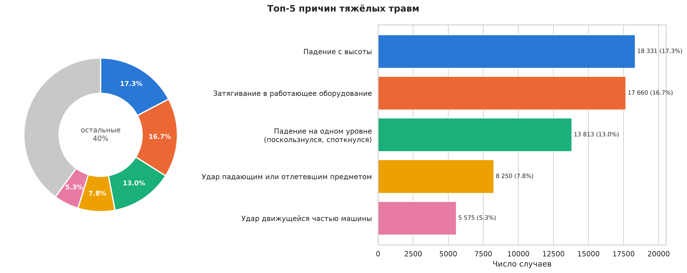
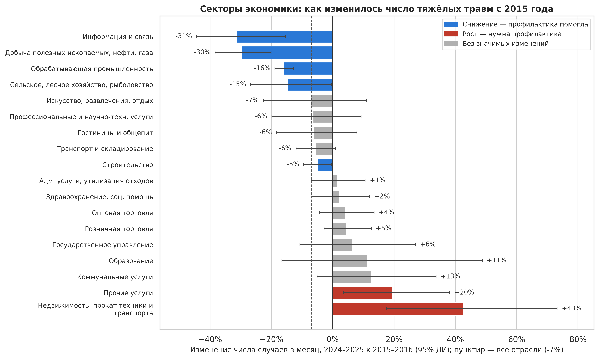
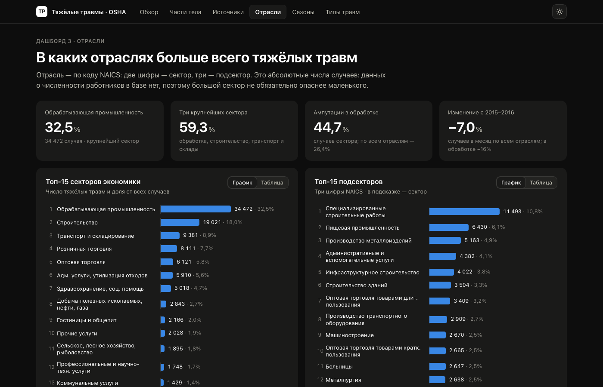
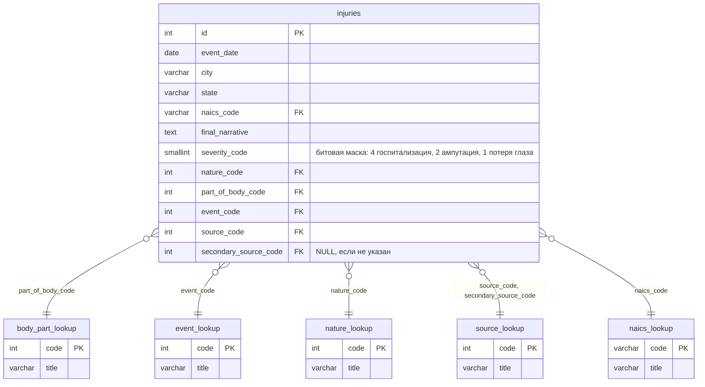

# Тяжёлые производственные травмы в США: база данных OSHA и анализ

[English version](README.md) · **[Интерактивные дашборды](https://samuelhidden.github.io/osha-severe-injuries/Report/)**

База данных PostgreSQL, собранная из отчётов OSHA о тяжёлых травмах (**105 996 случаев, январь 2015 – ноябрь 2025**),
и анализ на SQL и Python: какие части тела, источники, причины, отрасли и штаты дают больше всего тяжёлых травм и где
их число с 2015 года снизилось или выросло.

**Стек:** PostgreSQL · SQL · Python (pandas, SQLAlchemy, SciPy, statsmodels) · matplotlib / seaborn · Jupyter

## Главные выводы

- **Пальцы рук** страдают чаще всего: **29%** всех тяжёлых травм, почти каждая третья.
- **Пять причин дают 60% случаев:** падение с высоты (17,3%), затягивание в работающее оборудование (16,7%, из них
  72% — ампутации), падение на одном уровне (13,0%), удар падающим или отлетевшим предметом (7,8%), удар движущейся
  частью машины (5,3%).
- **Самые частые источники:** полы и поверхности (11,8%), погрузчики и паллетные тележки (5,7%), лестницы (5,6%).
- **Обрабатывающая промышленность (32,5%) и строительство (18,0%)** вместе дают половину случаев, топ-5 секторов — 73%.
- **2024–2025 против 2015–2016 (случаев в месяц):** по всем отраслям −7%. В обрабатывающей промышленности значимое
  снижение на 16%; значимый рост — склады (+32%), ремонт и обслуживание (+31%), амбулаторная медицина (+30%)
  (95% ДИ, отношение частот Пуассона).





> Это абсолютные числа: данных о численности работников в базе нет, поэтому снижение может объясняться и меньшей
> занятостью или неполной отчётностью, а не только профилактикой. Штаты с собственными программами охраны труда
> (State Plan, например California) представлены неполно.

## Интерактивные дашборды

Пять дашбордов на чистом HTML (без внешних библиотек): части тела, источники травм, отрасли, сезонность и типы
травм. Подсказки при наведении, переключатель «График / Таблица», светлая и тёмная темы.
**[Открыть онлайн](https://samuelhidden.github.io/osha-severe-injuries/Report/)** или локально — `Report/index.html`. PDF-версии — в [`Report/pdf`](Report/pdf).

[](https://samuelhidden.github.io/osha-severe-injuries/Report/03_industries.html)

## База данных

Схема «звезда»: одна факт-таблица и пять справочников, все внешние ключи заданы в базе.



| Таблица | Строк | Что хранит |
|---|---:|---|
| `injuries` | 105 996 | один тяжёлый случай: дата, место, отрасль, коды OIICS, описание |
| `source_lookup` | 1 643 | источники травмы (OIICS), общий для основного и вторичного источника |
| `naics_lookup` | 2 442 | отрасли (NAICS 2022) |
| `event_lookup` | 476 | типы происшествий — как получена травма (OIICS) |
| `nature_lookup` | 251 | характер травмы: перелом, ампутация, ожог… (OIICS) |
| `body_part_lookup` | 205 | части тела (OIICS) |

Схема — [`SQL/00_schema.sql`](SQL/00_schema.sql), загрузка — [`SQL/00_load.sql`](SQL/00_load.sql).
Особенности данных (смена редакции OIICS, старые коды NAICS, заглушки) — в [`SQL/README.md`](SQL/README.md).

## Структура репозитория

```
Data/
  Raw/                     исходные CSV (в репозиторий не входят, см. «Источники данных»)
  processed/
    pre-process.ipynb      очистка и нормализация исходной выгрузки
    prepare_csv.py         разбиение на факт-таблицу и справочники
    DataBaseFiles/         шесть CSV, готовых к загрузке в PostgreSQL
SQL/
  00_schema.sql            таблицы, ключи, ограничения, индексы
  00_load.sql              загрузка CSV через \copy
  01–08_*.sql              аналитические запросы по темам
Analysis/
  notebooks/01–10_*.ipynb  ноутбуки анализа, каждый заканчивается выводами
  src/                     доступ к БД, стиль графиков, статистика, русские подписи
  figures/ru, figures/en   графики на русском и английском (PNG 300 dpi + SVG)
  tables/                  итоговые таблицы (CSV)
Report/
  index.html               интерактивные дашборды (открыть в браузере)
  build.py                 пересборка данных дашбордов из Analysis/tables
```

| Тема | SQL | Ноутбук |
|---|---|---|
| Части тела | [01_body_parts.sql](SQL/01_body_parts.sql) | [01_body_parts](Analysis/notebooks/01_body_parts.ipynb) |
| Источники травмы | [02_sources.sql](SQL/02_sources.sql) | [02_sources](Analysis/notebooks/02_sources.ipynb) |
| Отрасли (NAICS) | [03_industries.sql](SQL/03_industries.sql) | [03_industries](Analysis/notebooks/03_industries.ipynb) |
| Годы и сезонность | [04_years.sql](SQL/04_years.sql) | [04_years_seasons](Analysis/notebooks/04_years_seasons.ipynb) |
| Типы происшествий | [05_events.sql](SQL/05_events.sql) | [05_events](Analysis/notebooks/05_events.ipynb) |
| Характер травмы | [06_nature.sql](SQL/06_nature.sql) | [06_nature](Analysis/notebooks/06_nature.ipynb) |
| География | [07_geography.sql](SQL/07_geography.sql) | [07_geography](Analysis/notebooks/07_geography.ipynb) |
| Сценарии, Парето, концентрация | [08_scenarios.sql](SQL/08_scenarios.sql) | [08_scenarios](Analysis/notebooks/08_scenarios.ipynb) |
| Сводка: топ-5 и изменения с 2015 года | — | [09_top5_summary](Analysis/notebooks/09_top5_summary.ipynb) |
| Типы травм по месяцам | [06_nature.sql](SQL/06_nature.sql) (6.4) | [10_nature_by_month](Analysis/notebooks/10_nature_by_month.ipynb) |

## Как воспроизвести

Нужны PostgreSQL 14+ и Python 3.10+.

```bash
# 1. Создать базу и загрузить данные (из корня репозитория)
createdb OSHA_db
psql -d OSHA_db -f SQL/00_schema.sql
psql -d OSHA_db -f SQL/00_load.sql

# 2. Окружение Python и параметры подключения
cd Analysis
python3 -m venv .venv && source .venv/bin/activate
pip install -r requirements.txt
cp .env.example .env        # вписать PG_PASSWORD и остальные параметры

# 3. Перезапустить все ноутбуки (из папки Analysis/)
for n in notebooks/[01]*.ipynb; do jupyter nbconvert --to notebook --execute --inplace "$n"; done
```

CSV в `Data/processed/DataBaseFiles` уже подготовлены. Чтобы собрать их заново из исходной выгрузки, скачайте
источники ниже в `Data/Raw/` и выполните `Data/processed/pre-process.ipynb`.

## Источники данных

- **OSHA Severe Injury Reports**, январь 2015 – ноябрь 2025:
  <https://www.osha.gov/severe-injury-reports> (файл `January2015toNovember2025.csv`)
- **2022 NAICS Structure**, U.S. Census Bureau: <https://www.census.gov/naics/> (файл `2022_NAICS_Structure.csv`)

Оба набора опубликованы федеральными ведомствами США и находятся в общественном достоянии.
